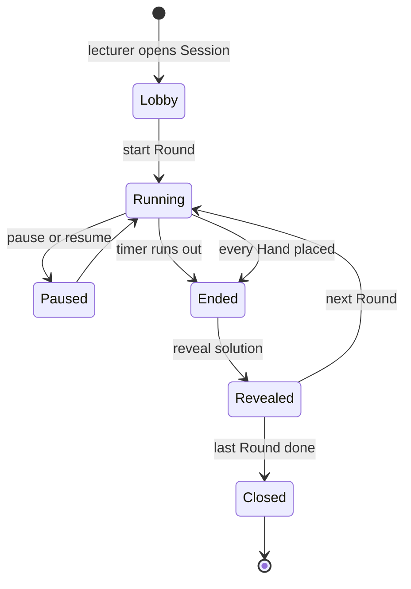
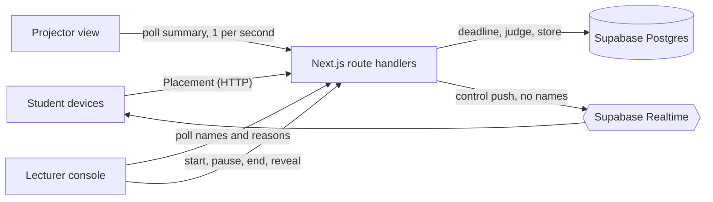

# CodeLine prototype: design decisions

Decisions from the design grilling session of Thu 19 Nov 2026.
Domain terms (Exercise, Slot, Snippet, Hand, Board, Round, and so on) are defined in `../GLOSSARY.md`.

## Purpose and deadlines

The prototype is the UI deliverable of CSC213 Term Project 2.
It is due on CSCMS on Fri 20 Nov 2026 at 11:59 PM, as a PDF that links to the live prototype.
The same prototype is demonstrated in the presentation on Thu 26 Nov 2026 in CB2312.
All layers are built on Thu 19 Nov.
Whether the prototype may still change after the Friday submission is to be asked in class on the morning of Thu 19 Nov.

## Evidence rule

Interview session 1 (Thu 29 Oct 2026) is the only interview evidence; session 2 was not held.
Answer IDs such as `S1-LEC-12` refer to `C:\Users\user\csc213-project2\notes\S1-2026-10-29.md`.
Anything without an S1 ID is a team proposal and must be labelled as one in the PDF and the report.
The app itself carries no source tags.

## Decisions

| # | Topic | Decision | Source |
|---|---|---|---|
| 1 | Target | Working prototype for the Friday PDF and the 26 Nov demo; the fallback is any other Postgres database, with students polling if Realtime fails | Brief, slide 6 |
| 2 | Core mechanic | Each student is dealt a Hand of Snippets; the lecturer sets the Hand size per Session; a Hand of one is the paper version; the whole Hand is visible and can be placed in any order | S1-HOD-03, S1-LEC-01; larger Hands are a team proposal |
| 3 | Board | Each student places on their own Board; the projector shows the Class Board, which combines every Board | S1-LEC-09; aggregation is a team proposal |
| 4 | Wrong Placement | Shown as wrong at once; the student may retry until the Round ends | S1-LEC-12 |
| 5 | Session shape | A Session is a playlist of one or more Rounds, one Exercise per Round; each Round ends on its timer or when every student has placed every Snippet | S1-LEC-05; playlist is a team proposal |
| 6 | Scoring | Accuracy first, speed second (formula below); reasons earn nothing automatically, only through a Spotlight | S1-LEC-14 (scoring possible, unsure); formula is a team proposal |
| 7 | Visibility | Projector shows the top 5 by nickname; each student sees their own rank privately; the lecturer sees real names; the lecturer can rename rude nicknames | Team proposal |
| 8 | Modes | Solo or Teams per Session; Teams are random, balanced, scored by average; a class progress bar is always on the projector | S1-LEC-07, S1-LEC-08 |
| 9 | Accounts | Normal sign-up (student ID, name, password) and sign-in; a student enrols in a Course once by entering its Join code, shown as a code and QR on the projector | S1-IT-05; method is a team proposal |
| 10 | Onsite only | Not in the prototype; described in the report as a future improvement (see below) | S1-LEC-04, S1-IT-02 |
| 11 | Authoring | Paired-rows editor: paste code, it splits into rows, write a pseudocode step beside each, mark Given Slots, pick the language, test play | S1-LEC-01, S1-LEC-15, S1-HOD-08, S1-LEC-16 |
| 12 | Live views | A public Projector view and a private Lecturer console; the console works on an extended display or a phone as a remote | S1-LEC-09, S1-LEC-11 |
| 13 | Roles | Student, Lecturer, Teaching assistant; no head-of-department screens | S1-LEC-15; TA is a team proposal; HoD screens dropped by team decision despite S1-HOD-11 |
| 14 | Dashboards | Lecturer: student table, drill-down to every Placement and reason, hardest-steps strip with the most common wrong Slot; TA: the same across all Courses, with export | S1-HOD-12, S1-LEC-09 |
| 15 | Theme | Code Garden: a cozy pixel-art valley with Codedex-style progression, all art original or CC0 | Team proposal |
| 16 | Progression | XP and Levels with cosmetic avatar items, Badges, and the Almanac; no attendance streaks | Team proposal; streak rejected because the lecturer controls when Sessions run (S1-LEC-03) |
| 17 | Input | Tap a Snippet then tap a Slot on every device, drag-and-drop on laptops too; phones stack each step above its Slot with a sticky Hand tray; a skippable "Why?" box after each Placement | S1-IT-01, S1-HOD-03, S1-LEC-10 |
| 18 | Art | All pixel art drawn for CodeLine in code (character grids rendered as SVG, plus CSS); no third-party art; fonts under the SIL Open Font License, credited on the About page | Team decision |
| 19 | Traceability | Only in the Friday PDF and the report, not in the app | Team decision |
| 20 | Friday PDF | Cover with URL, QR and demo logins; one page per business process with captioned screenshot flows; screen inventory; screenshots captured automatically | Slide 6 |
| 21 | Repo | Private GitHub repo at `C:\Users\user\codeline`; interview sources stay outside it | Slide 5 forbids sharing with other teams |
| 22 | Stack | Next.js on Vercel with Supabase Postgres and Supabase Realtime; CodeLine's own sign-in instead of Supabase Auth; all database access goes through one thin repository module | Team decision |
| 23 | Live sync | Low-chatter: Placements over HTTP; the projector and console poll a summary about once a second; Rounds end on a stored deadline; students get only a few content-free control pushes per Round, with polling as the fallback | S1-IT-03, S1-IT-04 |

## Scoring formula

Points for one correct Placement:

- Base: 1000.
- Retries: multiplied by 1, 0.5, 0.25, then a floor of 0.1.
- Speed bonus: up to +30%, scaled by the time left in the Round.
- Streak: multiplied by 1.1, 1.2 and so on for first-try Placements in a row, capped at 1.5.
- Spotlight: +300 when the lecturer features the student's reason.

A wrong Placement costs no Points but resets the streak.
Points reset when the Session ends; lifetime Points become XP.

## Session and Round lifecycle

Enrolled students can join while the Session is in the Lobby or a Round is Running.

## Live sync budget

Supabase Realtime's free plan allows 200 concurrent connections and 100 events per second.
A broadcast counts once for every client that receives it, so one push to 200 students is 200 events.
Vercel runs only short request handlers, so nothing on the server can tick a timer or push a summary every second.

The design follows from those two facts:

- Students send each Placement over HTTP; the handler checks the Round's deadline, judges the Placement and stores it.
- Each Round stores an absolute deadline, and devices count down against the server's clock, so a Round ends on time even if no screen is open.
- The projector and the console poll a summary about once a second; there are only two of them, so they need no Realtime.
- Students receive only control pushes (Round started, paused, ended, revealed), carrying the phase, the Round number and the deadline, never names or reasons.
- The console's browser sends the "Round ended" push when the deadline passes and runs the simulated classmates.
- A student device that loses its Realtime connection polls the Session state every few seconds instead.

Pushes to students stay well inside the free plan up to about 90 students per Session.
The full 200 at the same time (S1-IT-03) needs Supabase's paid tier or a dedicated room server; the report states this.

## Sign-in

Supabase Auth limits sign-ins to 30 per 5 minutes per IP address by default, and a whole classroom on one Wi-Fi shares one public IP.
CodeLine therefore signs people in itself: a users table with hashed passwords, and a session cookie that page scripts can't read.
The cookie has no expiry date, so a login ends when the browser closes, and the next student at a shared classroom computer doesn't find the last one still signed in.
The server also ends every login after 14 days, for a browser that is never closed.
Supabase is used only for Postgres and Realtime, and only the server talks to the database.

## Hosting

- The app runs on Vercel at `codeline.layaungphyo.dev`, through a CNAME record for `codeline` pointing at the target Vercel shows for the project.
- Vercel issues the HTTPS certificate, which `.dev` domains require.
- The Supabase project and Vercel's Functions region are both in Singapore, so each request stays close to Bangkok.
- The browser receives only the Supabase project URL and the publishable key, which Realtime needs.
- The secret key lives only in Vercel's server environment variables and never has a `NEXT_PUBLIC_` prefix.
- Local development runs Supabase in Docker, so no cloud account is needed to build and test.

## Future improvements

These go in the report as future work, not in the prototype.

- **Onsite-only access (S1-LEC-04, S1-IT-02).**
  Lock each Session to the public IP of the lecturer who opens its Lobby, with a "Re-lock to this network" button.
  Compare IPv4 addresses written in IPv6 form after converting them back, and compare IPv6 addresses by their /64 prefix.
  A refused student can knock, and the lecturer can let them in, which covers campuses with several outgoing IPs.
- **Roster import with activation codes (S1-IT-05).**
  The lecturer imports the class list, and each student's first sign-in needs a one-time code, so nobody can claim a classmate's student ID.
- **Sections.**
  A Join code per Section, so one lecturer's two sections of a Course get separate dashboards.
- **200 students at the same time (S1-IT-03).**
  Supabase's paid tier, or a dedicated room server per Session.
- **Head-of-department overview (S1-HOD-11).**

## Theme mapping

The garden words are only the skin; documents keep the glossary terms.

| Glossary term | Code Garden skin |
|---|---|
| Course | An area of the valley map, for example a Java meadow |
| Exercise | A crop |
| Slot | A soil plot beside a signpost |
| Pseudocode step | The signpost |
| Snippet | A seed |
| Hand | The seed pouch |
| Correct Placement | The seed sprouts and blooms |
| Wrong Placement | The sprout wilts back to a seed |
| Round timer | The sun crossing the sky, turning to dusk near the end |
| Round complete | Harvest |
| Class progress bar | The harvest basket |
| Session leaderboard | The town noticeboard |
| Team | A farm with its own banner colour |
| Spotlight | A notice pinned by the lecturer |
| Join code | The valley gate code |
| Almanac | The seed almanac of harvested crops |

## Defaults chosen without a separate question

- Dealing: CodeLine deals at random so that every dealt Snippet is held by about the same number of students; a Hand can't be larger than the number of non-Given Slots.
- The lecturer sets each Round's time limit (default 3 minutes), as S1-LEC-05 left open who sets it.
- The solution is revealed by the lecturer's button, prompted when a Round ends (S1-LEC-11).
- A Session belongs to one Course and appears as "Live now" for its enrolled students.
- In Teams mode the lecturer sets the number of Teams (default 4).
- Students choose a nickname on their profile.
- The UI is in English.
- Sound effects are generated in the browser and start off on every screen, with a toggle; there is no music.
- Sample data: CSC101 in Java (from the briefing) and one sample Python course, about 60 simulated students with history, all labelled as sample data.
- Simulated classmates: the Lecturer console can add simulated students to a Session, labelled as a demo tool.
- Daytime palette only; the dusk tint comes from the sun timer.

## To do

- Create a Supabase project in the Singapore region and a Vercel account, and check whether either asks for a card.
- Create the private GitHub repo `codeline`, import it into Vercel, and set the Functions region to Singapore.
- Add `codeline.layaungphyo.dev` in Vercel, then the `codeline` CNAME record at the DNS provider.
- Commits and pushes are run by the repo owner at the checkpoints flagged during the build; Vercel deploys on each push.
- Ask in class whether the prototype may change after the Friday submission.
- Supabase pauses free projects after 7 days without activity, and 19 to 26 Nov is exactly 7 days: open the app or the dashboard on 24 or 25 Nov.
